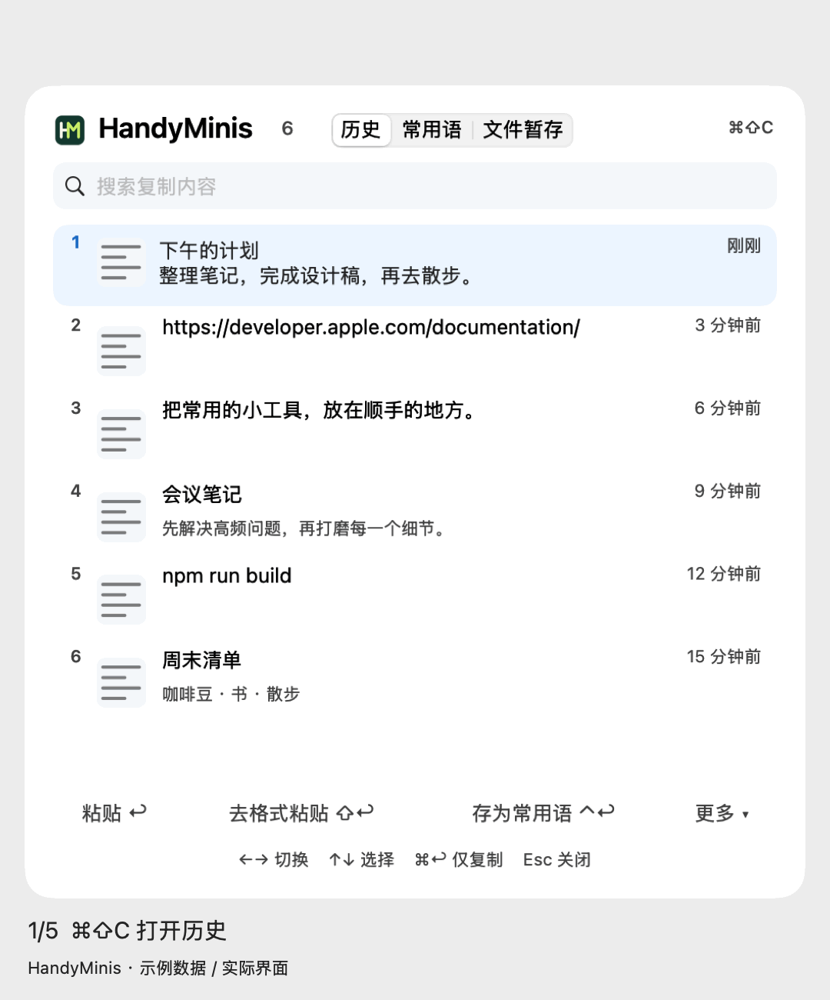
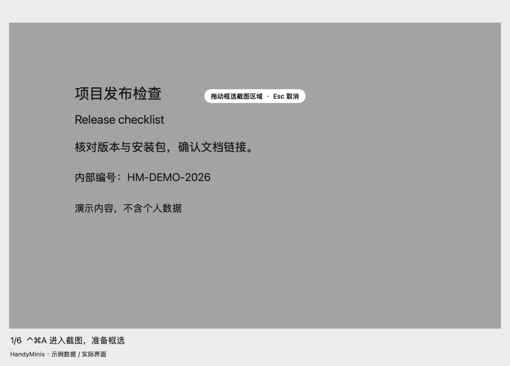
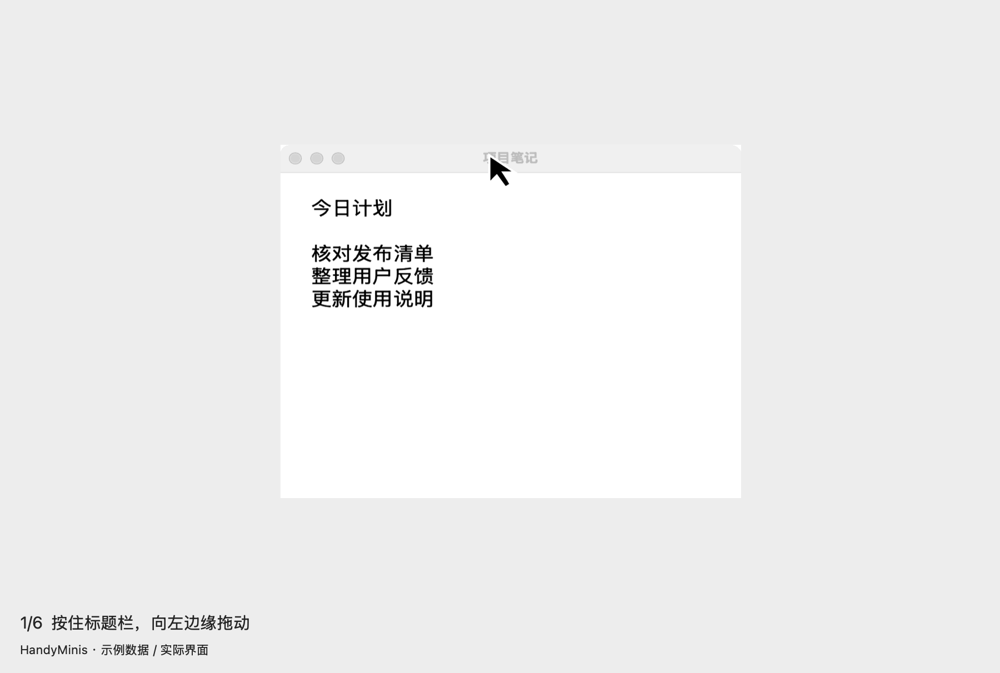

# DeskKit

DeskKit 是一款常驻 macOS 菜单栏的效率工具。它能找回复制过的内容，对截图做标注、打码和文字识别，也能把窗口拖到屏幕边缘快速排列。

[下载 DeskKit 1.0.3 通用版 DMG](https://github.com/IveHD/desk-kit/releases/download/v1.0.3/DeskKit-1.0.3-macOS-Universal.dmg) · [发布说明与 SHA-256 校验文件](https://github.com/IveHD/desk-kit/releases/tag/v1.0.3)

## 安装

需要 macOS 14 或更高版本，支持 Apple 芯片和 Intel Mac。

1. 打开 DMG，将 **DeskKit** 拖入「应用程序」。
2. 从「应用程序」启动，在菜单栏点击 **DK** 图标打开工具或设置。
3. 在「系统设置 → 隐私与安全性」中为需要使用的功能授权。自动粘贴与窗口贴靠需要「辅助功能」，截图需要屏幕录制权限。授予截图权限后重新打开 DeskKit。

发布包尚未经过 Apple 公证。若 macOS 阻止首次打开，请确认安装包来自此仓库，再按照「隐私与安全性」的系统提示操作。

## 核心功能演示

### 剪贴板历史

像平常一样按 **⌘C** 复制，再按 **⌘⇧C** 打开历史。输入关键词筛选，按 **↑ / ↓** 选择记录，按 **回车** 粘贴到刚才使用的应用。

- 保留最近 40 条文本、图片和文件。历史索引与图片合计上限为 64 MiB，达到任一上限会清理最旧的记录。重复复制会将已有记录移到顶部。
- **⌘1–⌘9** 粘贴对应记录，**⌘回车** 仅放回剪贴板。搜索框为空时按 **⌫** 删除记录，按 **Esc** 关闭。
- 可从菜单栏清空历史，也可以在设置中暂停收集。

### 截图、标注与 OCR

按 **⌃⌘A** 开始截图。鼠标悬停可预览推荐的窗口区域，单击选中，或拖动手动框选。截图模式覆盖所有显示器，每次导出当前屏幕的选区。

- **V** 调整选区，**R / O** 画矩形或椭圆，**A** 画箭头，**P** 自由绘制，**M** 加马赛克，**B** 加实心遮挡。绘图工具支持选择颜色、粗细和实线或虚线，箭头还可切换渐粗或等粗。
- **L** 逐点连线，双击最后一点或按 **回车** 完成。**T** 添加或重编文字，按 **回车** 换行，按 **⌘回车** 完成。
- **S** 选中并移动标记。**⌘Z** 撤销，**⇧⌘Z** 重做。
- **X** 在本机识别中英文。拖动选字后按 **⌘C** 复制文字，或按 **⌘A** 全选识别结果。工具栏可复制、保存或拖出 PNG。

### 拖拽整理窗口

在设置中开启「拖拽整理窗口」。拖动可调整大小的窗口标题栏，靠近屏幕边缘时预览半屏布局，靠近四角时预览四分之一布局。松手贴靠，拖离边缘取消。

布局使用当前显示器的可用区域，并受应用窗口最小尺寸限制。

演示使用示例内容，窗口贴靠 GIF 为布局示意。

## 设置与隐私

在菜单栏的「设置」中，可分别开关三项工具，修改剪贴板或截图快捷键，切换浅色、深色和跟随系统外观，并设置登录时启动。录制快捷键时按 **Esc** 取消，按 **⌫** 清除。

剪贴板历史和 OCR 都在本机处理。发布版的匿名使用统计可在设置中关闭，复制内容、图片和文件路径不会上传。新版本可从 [GitHub Releases](https://github.com/IveHD/desk-kit/releases) 获取。
