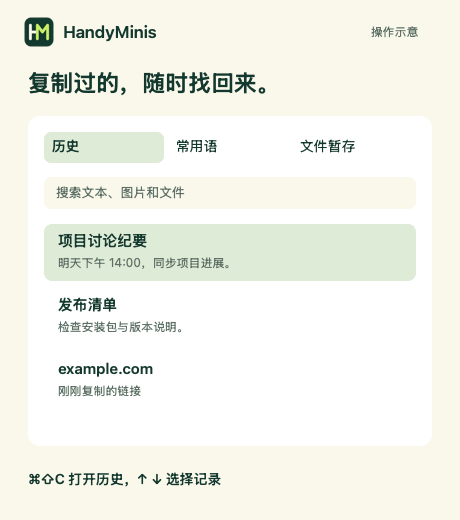
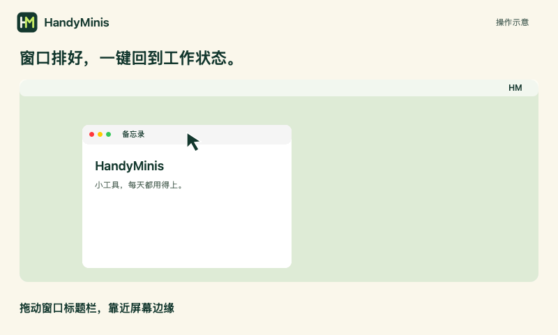

# HandyMinis · 顺手小工具


HandyMinis 是一组放在 macOS 菜单栏里的顺手小工具。用它找回复制内容、保存常用语和暂存文件，给截图打码或在本机提取文字，也可以贴靠窗口并保存和恢复布局。

[下载 HandyMinis 1.0.5（Universal DMG）](https://github.com/IveHD/handy-minis/releases/download/v1.0.5/HandyMinis-1.0.5-macOS-Universal.dmg) · [发布说明与 SHA-256 校验文件](https://github.com/IveHD/handy-minis/releases/tag/v1.0.5)

[HandyMinis 首页](https://ivehd.github.io/handy-minis/) · [截图打码和 OCR 指南](https://ivehd.github.io/handy-minis/guides/mac-screenshot-ocr/) · [剪贴板历史指南](https://ivehd.github.io/handy-minis/guides/mac-clipboard-history/)

## 1.0.5 更新

- **全新 HandyMinis 品牌**：采用 HM 共享笔画图标，菜单栏图标更小巧、轻量。
- **更清爽的外观**：调整浅色与深色主题，设置页新增面板配色、独立的浅深色自定义颜色、背景透明度及模糊开关，调整即时保存。
- **更顺滑的历史切换**：长文本采用有限预览与布局缓存，图片缩略图在后台解码；完整内容仍可搜索、查看、复制与粘贴。
- **保留完整工具集**：常用语、文件暂存、富文本与纯文本粘贴、文本清理、截图 OCR、窗口贴靠与布局保存恢复均继续提供。

原 DeskKit 用户升级前请先退出旧应用，再启动 HandyMinis，避免同时运行两个实例。新版本继续使用既有本机历史、常用语、窗口布局及偏好设置，无需手动迁移。

## 安装

需要 macOS 14 或更高版本，支持 Apple 芯片和 Intel Mac。

1. 打开 DMG，将 **HandyMinis** 拖入「应用程序」。
2. 从「应用程序」启动，在菜单栏点击 **HM** 图标打开工具或设置。
3. 在「系统设置 → 隐私与安全性」中为需要使用的功能授权。自动粘贴、窗口贴靠及窗口布局保存与恢复需要「辅助功能」，截图需要屏幕录制权限。授予截图权限后重新打开 HandyMinis。

未公证的构建使用临时签名；各发行包的签名与公证情况见对应发布说明。若 macOS 阻止首次打开，请确认安装包来自此仓库，再按照「隐私与安全性」的系统提示操作。

## 核心功能演示

### 剪贴板、常用语与文件暂存

按 **⌘⇧C** 打开剪贴板面板。用 **← / →** 切换「历史」「常用语」「文件暂存」，用 **↑ / ↓** 选择记录。



- **历史**保留最近 40 条文本、图片和文件。可搜索记录，按 **回车** 粘贴，或按 **⌘回车** 放回剪贴板。历史索引与图片合计上限为 64 MiB。
- **长内容预览**在列表里只排版前约 1,024 个字符，右键「查看全文…」可打开完整内容。搜索、复制和粘贴始终使用原始记录；图片缩略图在后台加载。
- **纯文本粘贴**按 **⇧回车** 去掉格式后粘贴。按 **⌥回车** 打开操作菜单，可清理多余空格、去掉折行并保留段落，或把文字合并为一行。
- **常用语**可用 **⌃回车** 将选中的文本存为带名称的短语，也可以在「常用语」分区直接新建。需要时搜索、复制或粘贴。
- **文件暂存**支持从历史加入文件，也可从 Finder 拖入。使用时可将暂存文件拖到目标应用。暂存列表仅在本次运行期间保留，移除条目不会删除原文件。

### 截图、标注与 OCR

按 **⌃⌘A** 开始截图。鼠标悬停可预览推荐的窗口区域，单击选中，或拖动手动框选。截图模式覆盖所有显示器，每次导出当前屏幕的选区。


- **V** 调整选区，**R / O** 画矩形或椭圆，**A** 画箭头，**P** 自由绘制，**M** 加马赛克，**B** 加实心遮挡。绘图工具支持选择颜色、粗细和实线或虚线，箭头还可切换渐粗或等粗。
- **L** 逐点连线，双击最后一点或按 **回车** 完成。**T** 添加或重编文字，按 **回车** 换行，按 **⌘回车** 完成。
- **S** 选中并移动标记。**⌘Z** 撤销，**⇧⌘Z** 重做。
- **X** 在本机识别中英文。拖动选字后按 **⌘C** 复制文字，或按 **⌘A** 全选识别结果。工具栏可复制、保存或拖出 PNG。

### 窗口贴靠与布局恢复

在设置中开启「拖拽整理窗口」。拖动窗口标题栏，靠近屏幕边缘或四角时预览半屏或四分之一布局，松手完成贴靠。



- **保存布局**。排好窗口后，从菜单栏的 **HM → 窗口布局 → 保存当前布局…** 记录当前桌面的窗口位置和大小。
- **恢复布局**。在当前桌面打开对应窗口，从「窗口布局」选择之前保存的布局名称。也可在同一菜单删除布局。
- 贴靠使用当前显示器的可用区域，并受应用窗口最小尺寸限制。

演示 GIF 均为使用示例内容制作的操作示意，实际界面以所安装版本为准。

## 设置与隐私

在菜单栏的「设置」中，可分别开关三项工具，修改剪贴板或截图快捷键，切换浅色、深色和跟随系统外观，并设置登录时启动。录制快捷键时按 **Esc** 取消，按 **⌫** 清除。

面板颜色提供系统默认、雾蓝、薄荷、暖沙和自定义；浅色与深色模式可以分别保存自定义颜色。背景透明度可在 0%–80% 间调节，并可开启背景模糊，文字和按钮保持完整不透明度。调整实时生效并自动保存，「恢复面板默认外观」只重置面板外观。系统开启「减少透明度」时，面板遵循系统设置保持不透明。

剪贴板历史和 OCR 都在本机处理。发布版的匿名使用统计可在设置中关闭，复制内容、图片和文件路径不会上传。新版本可从 [GitHub Releases](https://github.com/IveHD/handy-minis/releases) 获取。

## 从源码构建

```sh
scripts/setup-sparkle.sh
scripts/render-icons.sh
./build.sh
scripts/package-dmg.sh
```

生成 `HandyMinis.app` 和 `dist/HandyMinis-<版本>-macOS-Universal.dmg`。
`scripts/render-demos.sh` 可重新生成文档中的操作示意 GIF。

`scripts/test-clipboard-navigation.sh` 使用隔离的示例记录检查连续选择、搜索、删除后的选中位置、Unicode 边界、缩略图异步加载与视图复用，并输出选择与布局耗时及浅色、深色、设置页截图（`.build/tests/`）。测试不读取用户的剪贴板历史，也不写入系统剪贴板；耗时不包含显示器合成与真实按键输入延迟。

`scripts/test-release-features.sh` 验证既有常用语数据格式、常用语增删改查、富文本/纯文本复制、文本清理、三个分区、文件暂存与拖放，以及窗口布局接口。使用临时目录和独立测试剪贴板，需要在可连接 macOS 剪贴板服务的桌面会话中运行。

`scripts/test-panel-appearance.sh` 使用独立偏好域验证面板配色、背景透明度、模糊开关、实时更新、浅深色独立自定义、恢复默认及跨进程保存，并输出设置页截图。

HM 图标采用共享竖笔的连字设计：暖白 H 与青柠 M 收拢在深松绿圆角底板中；菜单栏使用同一字形的单色模板。应用图标、网站 SVG、favicon 和分享图由同一个脚本生成。

为延续升级兼容性，应用保留既有 Bundle ID `local.handong.ClipStack`、偏好设置键和本机数据目录；这些是内部兼容标识，不影响 HandyMinis 的显示名称。
